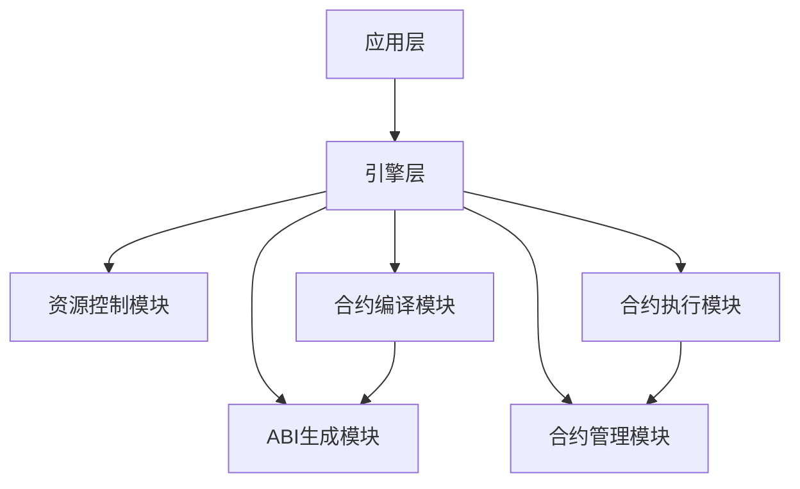

# VM 系统架构重构设计文档

## 1. 概述

本文档描述了 VM 系统的重构设计方案，旨在建立一个更加清晰、模块化的架构，提高系统的可维护性、可扩展性和安全性。重构后的系统将包含五个核心模块：ABI 生成模块、资源控制模块、合约管理模块、合约编译模块和合约执行模块。

## 2. 重构目标

1. **模块化设计**：将系统功能划分为独立的模块，降低模块间的耦合度
2. **职责清晰**：每个模块有明确的职责和接口
3. **可扩展性**：支持模块的独立扩展和替换
4. **可测试性**：提高各模块的可测试性
5. **安全性**：增强系统的安全机制

## 3. 核心模块设计

### 3.1 ABI 生成模块

#### 3.1.1 模块职责
- 解析 Go 源码并提取 ABI 信息
- 生成标准的 ABI 对象

#### 3.1.2 核心接口
```go
// ABIExtractor 定义了 ABI 提取器的接口
type ABIExtractor interface {
    // Extract 从源码中提取 ABI 信息
    Extract(code []byte) (*ABI, error)
}

// ABI 表示合约的应用程序二进制接口
type ABI struct {
    Functions   []Function `json:"functions,omitempty"`
    Events      []Event    `json:"events,omitempty"`
}

// Function 表示合约中的函数
type Function struct {
    Name    string      `json:"name,omitempty"`
    Inputs  []Parameter `json:"inputs,omitempty"`
    Outputs []Parameter `json:"outputs,omitempty"`
}

// Parameter 表示函数参数或事件字段
type Parameter struct {
    Name string `json:"name,omitempty"`
    Type string `json:"type,omitempty"`
}
```

### 3.2 资源控制模块

#### 3.2.1 模块职责
- 管理合约执行的资源消耗（默认为 GAS）
- 实现资源限制和计费机制

#### 3.2.2 核心接口
```go
// ResourceManager 定义了资源管理器的接口
type ResourceManager interface {
    // Consume 消耗指定数量的资源
    Consume(amount int64) error
    
    // GetRemaining 获取剩余资源
    GetRemaining() int64
}
```

### 3.3 合约管理模块

#### 3.3.1 模块职责
- 管理合约的存储（源码、编译后代码、ABI）
- 提供合约的注册、查询和删除功能

#### 3.3.2 核心接口
```go
// ContractManager 定义了合约管理器的接口
type ContractManager interface {
    // Register 注册新的合约
    Register(address Address, code []byte) error
    
    // GetCompiled 获取编译后的合约代码
    GetCompiled(address Address) ([]byte, error)
    
    // GetABI 获取合约 ABI
    GetABI(address Address) (*ABI, error)
    
    // Delete 删除合约
    Delete(address Address) error
}
```

### 3.4 合约编译模块

#### 3.4.1 模块职责
- 验证合约源码的合法性
- 将源码编译为 WebAssembly 二进制代码

#### 3.4.2 核心接口
```go
// ContractCompiler 定义了合约编译器的接口
type ContractCompiler interface {
    // Compile 将源码编译为 WASM 二进制代码
    Compile(code []byte) ([]byte, error)
}
```

### 3.5 合约执行模块

#### 3.5.1 模块职责
- 执行编译后的 WebAssembly 合约
- 管理合约的执行环境

#### 3.5.2 核心接口
```go
// ContractExecutor 定义了合约执行器的接口
type ContractExecutor interface {
    // Execute 执行合约函数
    Execute(ctx Context, contractAddr Address, functionName string, params []byte) (interface{}, error)
}
```

## 4. 模块间关系

### 4.1 架构图



### 4.2 数据流

1. **合约部署流程**：
   - 应用层提交合约源码
   - 合约编译模块编译源码
   - ABI 生成模块提取 ABI 信息
   - 合约管理模块存储合约信息

2. **合约执行流程**：
   - 应用层发起执行请求
   - 合约管理模块获取合约信息
   - 资源控制模块设置资源限制
   - 合约执行模块执行合约函数
   - 返回执行结果

## 5. 接口设计原则

### 5.1 简洁性原则
只保留必须的核心接口，避免功能冗余。

### 5.2 单一职责原则
每个模块只负责一个核心功能。

### 5.3 松耦合原则
模块间通过接口交互，降低依赖关系。

## 6. 安全设计

### 6.1 代码安全
- 源码验证机制防止恶意代码
- 导入包白名单控制

### 6.2 执行安全
- WebAssembly 沙箱执行环境
- 资源使用限制

## 7. 性能优化

### 7.1 编译优化
- 合约代码缓存机制
- 编译结果复用

### 7.2 执行优化
- WASM 模块缓存
- 状态数据索引优化

## 8. 总结

本次重构设计通过模块化的方式重新组织了 VM 系统的架构，使得各功能模块职责更加清晰，接口更加简洁，有利于系统的长期维护和扩展。新的架构设计充分考虑了安全性、性能和可扩展性，为构建稳定可靠的智能合约执行环境奠定了坚实的基础.